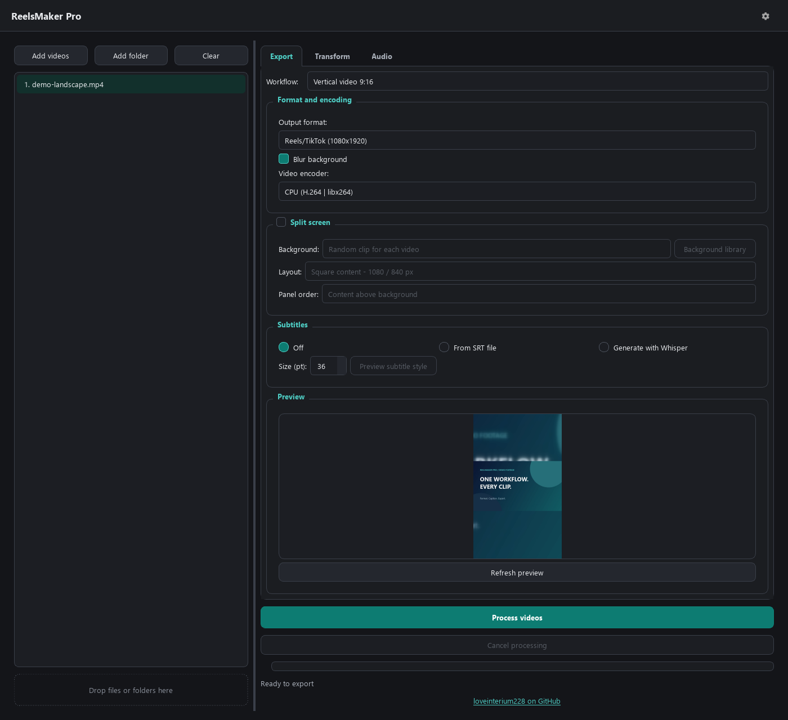
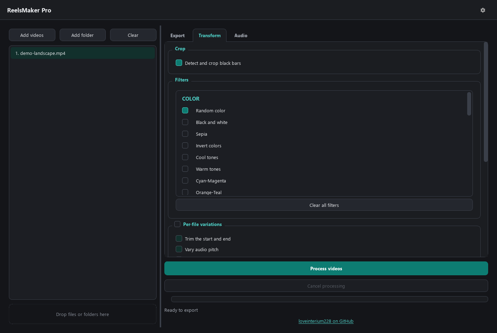
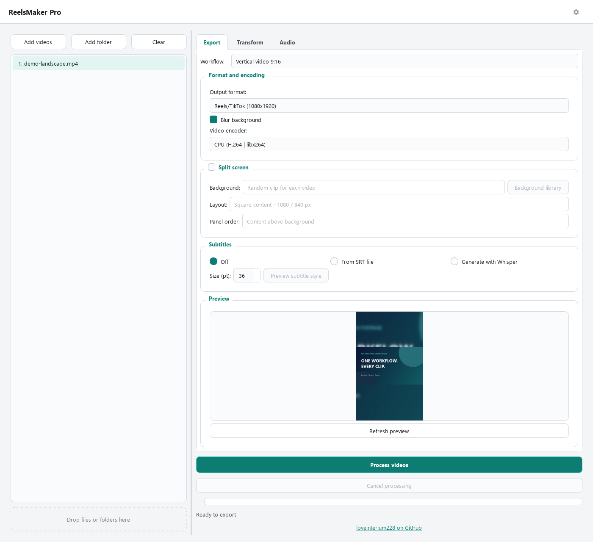
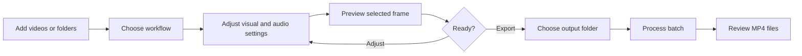
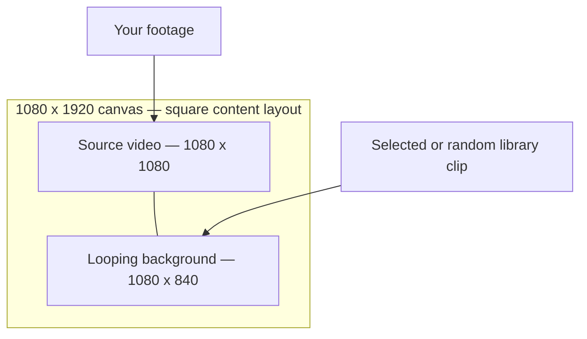
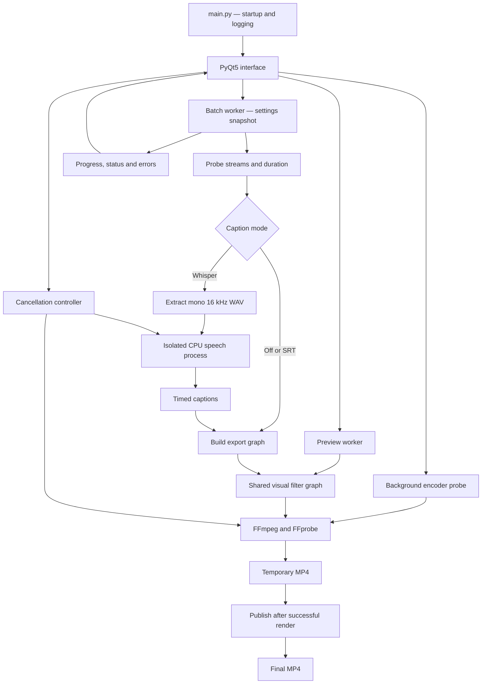
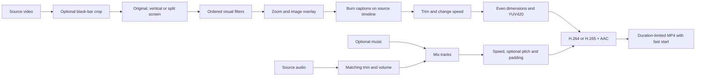

<div align="center">

# ReelsMaker Pro

### Your footage. A repeatable short-form workflow.

A desktop batch video editor for vertical clips, split-screen videos and burned-in captions — powered by local FFmpeg processing and local speech recognition.


[Quick start](#quick-start) · [Features](#features) · [Architecture](#architecture) · [Development](#development) · [Windows builds](docs/INSTALLATION.md#windows-application-build)



</div>

<details>
<summary>More screenshots: transform controls and light theme</summary>





</details>

ReelsMaker Pro turns a folder of source videos into consistently formatted MP4 files. Choose a workflow, adjust the visual and audio settings, preview a frame, and export the batch. It is designed for creators preparing footage for Reels, TikTok and Shorts who want direct control over the editing pipeline.

Media processing happens on your computer. Speech recognition uses `faster-whisper` in a separate CPU process; the first use downloads the model weights. The application requires no account or paid API key.

## Features

| Area | What you can do |
| --- | --- |
| Batch workflow | Add videos, import folders recursively, or drag files and folders into the queue. |
| Vertical export | Fit footage into a **1080 × 1920** canvas with black padding or a blurred background. |
| Split screen | Stack the source and a looping background clip; choose panel heights and order. |
| Visual effects | Combine **27 fixed filters**, randomized color adjustment and a random filter selector. |
| Transformations | Detect black bars, zoom, flip through filters, and change playback speed. |
| Captions | Burn an SRT or generate word-timed captions with Whisper. Edit font, size, colors, outline and position. |
| Overlays | Place PNG/JPG/BMP images or looping GIFs at one of nine positions. |
| Audio | Adjust source volume, mute the source, and mix music or narration with separate volume controls. |
| Encoding | Use CPU H.264 or available NVIDIA, Intel and AMD H.264/H.265 encoders. Each encoder is tested by rendering a frame. |
| File safety | Preserve existing exports, number name collisions, and publish each file after a successful render. |
| Job control | Track per-file and batch progress; cancel encoding or speech recognition. |
| Preferences | Switch dark/light themes, configure FFmpeg and save preferences between sessions. |

Optional **per-file variations** choose small changes to trim, pitch, speed and encoding quality. These editing parameters do not guarantee originality or acceptance by any platform.

## Quick start

### Requirements

- **Python 3.10+**; the reviewed Windows environment used Python 3.12.
- **FFmpeg and FFprobe** from the same distribution. Caption rendering needs an FFmpeg build with the `subtitles`/libass filter.
- A graphical desktop. Windows is locally validated. Linux/macOS paths are implemented; those platforms have not been manually validated in this review.
- Internet access for dependency installation and the first download of a Whisper model.

Download the source archive, or clone the repository:

```bash
git clone https://github.com/loveinterium228/ReelsMaker.git
cd ReelsMaker
python -m venv .venv
```

Activate the environment:

```powershell
# Windows PowerShell
.\.venv\Scripts\Activate.ps1
```

```bash
# Linux / macOS
source .venv/bin/activate
```

Install and run:

```bash
python -m pip install -r requirements.txt
python main.py
```

Get FFmpeg through the [official download page](https://ffmpeg.org/download.html). Put **both** executables in `ffmpeg/bin/`, add their directory to `PATH`, or select `ffmpeg.exe` in **Settings**. A custom path requires `ffprobe.exe` next to it. Linux/macOS executable names have no `.exe` suffix.

```text
ReelsMaker-Pro/
└── ffmpeg/
    └── bin/
        ├── ffmpeg.exe
        └── ffprobe.exe
```

See [the installation guide](docs/INSTALLATION.md) for packaging, model caching and troubleshooting.

## Editing a batch

1. **Add footage.** Import videos/GIFs or a folder. Select a queue item to preview.
2. **Choose a workflow.** Vertical video, Vertical video with captions, Split-screen video, Transcode only, or Custom settings.
3. **Adjust the tabs.** Export contains the canvas, encoder, split screen and captions. Transform contains crop, filters, zoom, speed and image overlays. Audio contains volume and music controls.
4. **Preview.** Refresh the visual frame. Use **Preview subtitle style** with an SRT to inspect caption styling.
5. **Export.** Click **Process videos**, choose a destination, and follow progress. **Cancel processing** stops the active job.



### Preview behavior

The main preview shows crop, canvas, filters, zoom, split screen and image overlays. It does **not** preview audio, burned captions, playback speed or per-file variations. Random settings use representative values; the final selection can differ. The subtitle dialog previews caption styling against the source frame before canvas conversion.

### Output rules

- Queue extensions: `.mp4`, `.mov`, `.avi`, `.mkv`, `.flv`, `.wmv`, `.gif`. Actual decoding depends on your FFmpeg build.
- Every export is **MP4**, with H.264/H.265 video and AAC when audio is present.
- **Original** preserves the source canvas with even dimensions for YUV420; it still re-encodes the video.
- Vertical output is **1080 × 1920**. Split-screen panels are center-cropped to fill their assigned area.
- A GIF source exports for one finite animation duration. GIF overlays and backgrounds loop as needed.
- The processed source duration controls output length. Short music is padded with silence; long music ends at the output boundary.
- Names use `_processed.mp4` or `_reels.mp4`. Existing files receive numbered alternatives, such as `_1`, `_2`.
- Failed files are reported and the batch continues. The final message distinguishes successes, failures and cancellation.
- Cancelling discards the current partial file; previously completed exports remain.

### Split-screen layouts

The canvas is 1080 pixels wide. Content can appear above or below the background.

| Layout | Content height | Background height |
| --- | ---: | ---: |
| Square content | 1080 px | 840 px |
| Equal panels | 960 px | 960 px |
| Larger content | 1280 px | 640 px |
| Larger background | 840 px | 1080 px |



Add personal clips through **Background library**. The application reads the bundled `resources/presets/` folder and your user library after restart. Random mode chooses a background separately for each export.

## Architecture

The UI snapshots the editing settings. A Qt worker processes files sequentially; FFmpeg and speech recognition run as child processes. The event loop stays responsive, and Qt remains isolated from the speech engine's native libraries.



### Render pipeline



Captions are rendered before trim and speed changes, so they follow the same timeline as the footage. Audio tempo follows the selected speed; optional pitch variation compensates tempo to retain duration.

### Project layout

```text
ReelsMaker-Pro/
├── main.py                         # Startup and logging
├── check_gpu.py                    # FFmpeg encoder report, without PyTorch
├── requirements.txt                # Runtime dependencies
├── requirements-dev.txt            # Tests, linting and packaging
├── pyproject.toml                  # Pytest and Ruff configuration
├── ui/
│   ├── main_window.py              # Queue, controls and preferences
│   └── subtitle_preview_dialog.py  # Caption style editor and preview
├── workers/worker.py               # Batch execution and safe output publishing
├── utils/
│   ├── ffmpeg_utils.py             # Discovery, probing and filter graphs
│   ├── process_utils.py            # Cancellation and subprocess cleanup
│   ├── subtitle_utils.py           # Audio extraction and worker launch
│   ├── transcribe_cli.py           # Qt-free transcription CLI
│   ├── constants.py                # Filters, workflows, layouts and models
│   ├── path_utils.py               # Resources and writable data paths
│   ├── file_utils.py               # Input discovery
│   ├── links.py                    # Public author links
│   ├── advanced_filters.py         # Standalone experimental filter helpers
│   └── audio_uniquify.py           # Standalone experimental audio helpers
├── resources/                      # Icons, themes, screenshot and backgrounds
├── tools/                          # Theme generator and Windows build helper
├── tests/                          # Media, speech boundary and Qt regressions
├── docs/                           # Installation, review and changelog
├── ReelsMakerPro.spec               # PyInstaller GUI bundle
├── transcriber.spec                 # Separate PyInstaller speech bundle
└── installer.iss                    # English Inno Setup installer
```

## Development

```bash
python -m pip install -r requirements-dev.txt
python -m ruff check .
python -m pytest -q
```

Tests render short synthetic clips with real FFmpeg. Coverage includes silent inputs, GIFs, every filter choice, zoom, speed, split screen, music duration, captions, cancellation and batch file safety. Speech tests exercise language mapping and the actual decoder without model downloads. A separate real-model smoke check is documented in [the review](docs/REVIEW.md).

FFmpeg/FFprobe must be on `PATH` for tests, or set `FFMPEG_BINARY` and `FFPROBE_BINARY`. Qt tests use offscreen rendering. A GitHub Actions workflow targets Python 3.10 and 3.12; hosted results become available after pushing the repository.

Regenerate themes after editing the shared tokens:

```bash
python tools/build_styles.py
```

## Troubleshooting

| Symptom | What to check |
| --- | --- |
| FFmpeg / FFprobe missing | Install both tools and use `PATH`, `ffmpeg/bin/`, or Settings. |
| Hardware encoder unavailable | Choose CPU H.264; check your graphics driver and FFmpeg encoder support. |
| Subtitle filter unavailable | Install an FFmpeg build with libass support. |
| Slow first transcription | The model may be downloading. Start with `tiny` or `base` on CPU. |
| Transcription fails after upgrading | Reinstall `requirements.txt`; the PyAV pin is needed by this faster-whisper version. |
| Some files fail | Inspect each file error and the final batch counts; completed outputs remain available. |
| Empty background library | Add a readable background clip or choose a custom file. |

Logs and preferences live in `%APPDATA%/ReelsMakerPro/` on Windows, `~/Library/Application Support/ReelsMakerPro/` on macOS, or `$XDG_DATA_HOME/ReelsMakerPro/` (default `~/.local/share/ReelsMakerPro/`) on Linux. Logs contain local paths and render diagnostics.

## License and author

Application source: [MIT License](LICENSE). Libraries, FFmpeg distributions and media have separate terms; see [third-party notes](THIRD_PARTY_NOTICES.md).

Built and maintained by **[loveinterium228](https://github.com/loveinterium228)**.

See [review evidence](docs/REVIEW.md) and [the changelog](docs/CHANGELOG.md) for the maintenance work.
